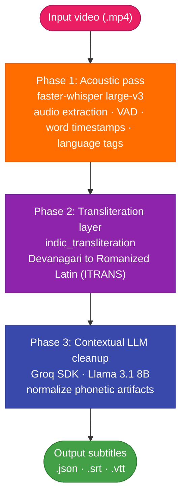
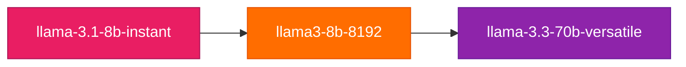
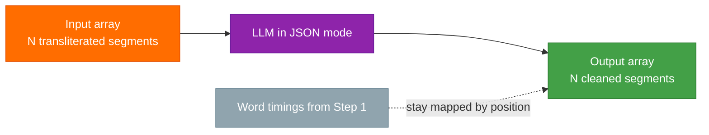
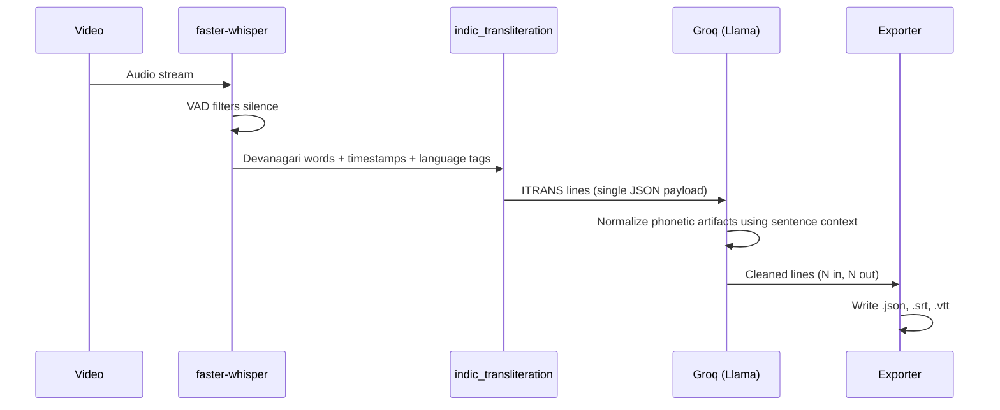
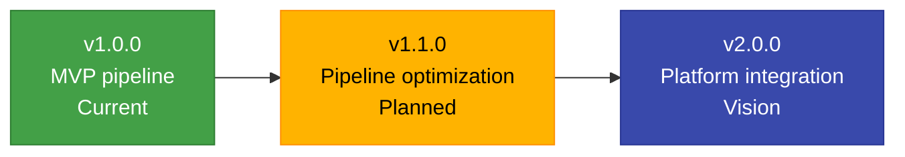

<!-- HEADER (no image files needed: everything below loads from shields.io) -->
<div align="center">

<h1>CapFlow</h1>

<h3>Multi-stage caption engine for code-switched Hinglish (Hindi + English) video</h3>

<p>
  
  
  
</p>

<p>
  
  
  
  
  
  
</p>

<p>
  
  
  
</p>

</div>

<p align="center">
  <a href="#overview">Overview</a> ·
  <a href="#architecture-overview">Architecture</a> ·
  <a href="#tech-stack-and-version-matrix">Tech Stack</a> ·
  <a href="#key-pipeline-features">Features</a> ·
  <a href="#how-it-works">How It Works</a> ·
  <a href="#quickstart-guide">Quickstart</a> ·
  <a href="#output-artifacts">Outputs</a> ·
  <a href="#system-design-qa">Design Q&amp;A</a> ·
  <a href="#roadmap">Roadmap</a> ·
  <a href="#glossary">Glossary</a> ·
  <a href="#faq">FAQ</a>
</p>

---

## Table of Contents

| # | Section | What you will find |
|:-:|---|---|
| 1 | [Overview](#overview) | The Hinglish captioning problem and what CapFlow does about it |
| 2 | [Architecture Overview](#architecture-overview) | The three-phase pipeline end to end |
| 3 | [Tech Stack and Version Matrix](#tech-stack-and-version-matrix) | Dependencies, minimum versions and roles |
| 4 | [Key Pipeline Features](#key-pipeline-features) | Language tagging, normalization, failover, length guarantee |
| 5 | [How It Works](#how-it-works) | Step-by-step walkthrough |
| 6 | [Quickstart Guide](#quickstart-guide) | Install, configure, run |
| 7 | [Output Artifacts](#output-artifacts) | `.json`, `.srt` and `.vtt` exports |
| 8 | [System Design Q&A](#system-design-qa) | Why the pipeline is built this way |
| 9 | [Roadmap](#roadmap) | v1.0.0, v1.1.0 and v2.0.0 |
| 10 | [Glossary](#glossary) | Terms and tools explained |
| 11 | [FAQ](#faq) | Common questions |
| 12 | [Author](#author) | Who built it |

---

## Overview

**CapFlow** is an automated, multi-stage caption generation engine built to process code-switched **Hinglish (Hindi + English)** videos.

When speakers mix Hindi and English mid-sentence, standard Automatic Speech Recognition (ASR) engines struggle. They often output English loanwords as phonetic Hindi transliterations or mangled spellings.

| Spoken English word | What a standard ASR pass produces | What CapFlow produces |
|---|---|---|
| *egg rice* | `egaraysa` | `egg rice` |
| *practice* | `praiktisa` | `practice` |

CapFlow resolves these phonetic artifacts by running a **3-step pipeline**:

1. **Transcribe** the audio with word-level timestamps.
2. **Transliterate** native script into Roman letters.
3. **Clean up** the result with an LLM post-processing pass to produce human-readable Hinglish captions.

### At a glance

| 1. Acoustic pass | 2. Transliteration | 3. Contextual cleanup | Output |
|:---:|:---:|:---:|:---:|
| `faster-whisper large-v3` with VAD filtering | Devanagari to Roman letters (ITRANS) | Groq-hosted Llama normalizes phonetic artifacts | `.json`, `.srt`, `.vtt` |

---

## Architecture Overview



<details>
<summary><b>Text version of the architecture diagram</b></summary>

```text
                          ┌───────────────────────────┐
                          │   Input Video (.mp4)      │
                          └─────────────┬─────────────┘
                                        │
                                        ▼
┌───────────────────────────────────────────────────────────────────────────────┐
│ Phase 1: Acoustic Pass (faster-whisper large-v3)                              │
│ • Extracts audio & applies VAD filtering (silence removal)                    │
│ • Emits word-level timestamps & language tags (Hindi vs. English)             │
└──────────────────────────────────────┬────────────────────────────────────────┘
                                       │
                                       ▼
┌───────────────────────────────────────────────────────────────────────────────┐
│ Phase 2: Transliteration Layer (indic_transliteration)                        │
│ • Converts Hindi Devanagari script into Romanized Latin text (ITRANS format)  │
│ • Preserves exact token timing while unifying character encodings             │
└──────────────────────────────────────┬────────────────────────────────────────┘
                                       │
                                       ▼
┌───────────────────────────────────────────────────────────────────────────────┐
│ Phase 3: Contextual LLM Cleanup (Groq SDK / Llama 3.1 8B)                     │
│ • Evaluates full sentence context to normalize phonetic artifacts             │
│ • Maps raw ITRANS tokens to standard English/Hinglish                         │
│   ("egaraysa" -> "egg rice")                                                  │
└──────────────────────────────────────┬────────────────────────────────────────┘
                                       │
                                       ▼
                          ┌───────────────────────────┐
                          │ Output Subtitles          │
                          │ (.json, .srt, .vtt)       │
                          └───────────────────────────┘
```

</details>

### Phase summary

| Phase | Component | Responsibilities |
|---|---|---|
| **1. Acoustic pass** | `faster-whisper large-v3` | Extract audio, apply VAD (silence removal), emit word-level timestamps and Hindi/English language tags |
| **2. Transliteration layer** | `indic_transliteration` | Convert Devanagari into Romanized Latin text (ITRANS), preserving exact token timing and unifying character encodings |
| **3. Contextual LLM cleanup** | Groq SDK, Llama 3.1 8B | Read full-sentence context and map raw ITRANS tokens to standard English or Hinglish |

---

## Tech Stack and Version Matrix

| Dependency | Minimum version | Role in pipeline |
|---|---|---|
| **Python** | `3.10+` | Core runtime environment |
| **faster-whisper** | `0.10.0+` | CTranslate2-optimized implementation of OpenAI Whisper (`large-v3`) |
| **indic-transliteration** | `2.3.0+` | Devanagari to ITRANS Latin script conversion |
| **groq** | `0.4.0+` | Low-latency inference client for Llama 3 API execution |
| **numpy** | `1.24.0+` | Probability distribution analysis and confidence scoring |
| **pydantic / dataclasses** | Native | Data schema validation and JSON payload serialization |

<p align="center">
  
  
  
  
  
</p>

---

## Key Pipeline Features

| Feature | What it does |
|---|---|
| **Word-level code-switching detection** | Assigns per-word language origin tags (`hi` vs. `en`) along with probability confidence scores |
| **Contextual orthographic normalization** | Automatically fixes spoken Indian English loanwords without relying on brittle, hardcoded word dictionaries |
| **Automatic LLM failover** | Cycles dynamically through Groq candidate endpoints to protect against single-model API downtime |
| **Payload length guarantee** | Enforces structured JSON output matching input segment array sizes (N → N), preventing subtitle timing drift |

### Automatic LLM failover order



### Payload length guarantee (N → N)



---

## How It Works



### Step 1: Acoustic Processing and VAD

`faster-whisper` processes the input video's audio stream.

**Voice Activity Detection (VAD)** filters out silent intervals to prevent acoustic hallucination loops.

The model assigns a **confidence score and language tag** to every spoken word token.

| Output of Step 1 | Detail |
|---|---|
| Word tokens | Each spoken word, in native script where applicable |
| Timestamps | Word-level start and end times |
| Language tag | `hi` or `en`, per word |
| Confidence | Probability score per word |

### Step 2: Indic Transliteration

Whisper output generated in native Devanagari script is mapped into Latin characters while maintaining token-level start and end timestamps.

| Devanagari | Transliterated |
|---|---|
| `और` | `aura` |
| `चाय` | `chaya` |

The raw Roman output is intentionally literal. It is a phonetic rendering, not yet readable Hinglish, which is why Step 3 exists.

### Step 3: Contextual Cleanup Pass

The transliterated lines are sent to Groq's API in a **single JSON payload**.

The LLM evaluates surrounding sentence context to normalize phonetic artifacts:

| Raw transliteration | Normalized |
|---|---|
| `gaisa` | `guys` |
| `kritika` | `critique` |
| `vidiyo` | `video` |
| `egaraysa` | `egg rice` |
| `praiktisa` | `practice` |

Because the model reads the whole sentence, the fix is based on context rather than a lookup table.

### Pipeline data flow

| Stage | Receives | Produces | Timing preserved? |
|---|---|---|:---:|
| Acoustic pass | Video audio | Words, timestamps, language tags, confidences | Created here |
| Transliteration | Devanagari tokens | Roman (ITRANS) tokens | ✅ |
| LLM cleanup | Roman lines, as one JSON array | Cleaned lines, same array length | ✅ |
| Export | Cleaned lines + timings | `.json`, `.srt`, `.vtt` | ✅ |

---

## Quickstart Guide

### 1. Installation

```bash
git clone https://github.com/stutikatiyar/CapFlow.git
cd CapFlow/backend

# Create and activate virtual environment
python -m venv venv
.\venv\Scripts\activate      # On Windows
# source venv/bin/activate   # On Linux/macOS

pip install -r requirements.txt
```

### 2. Set API key

Get an API key from [console.groq.com](https://console.groq.com) and declare it in your environment.

**Windows (PowerShell):**

```powershell
$env:GROQ_API_KEY="gsk_YOUR_GROQ_API_KEY"
```

**Linux / macOS:**

```bash
export GROQ_API_KEY="gsk_YOUR_GROQ_API_KEY"
```

> [!WARNING]
> Never commit your real API key. Keep it in an environment variable, and add any local `.env` file to `.gitignore`.

### 3. Run the pipeline

```bash
python -m app.services.transcription.run_feature_3 --input storage/uploads/test_hinglish.mp4
```

### Troubleshooting checklist

- [ ] The virtual environment is activated and `pip install -r requirements.txt` finished without errors
- [ ] `GROQ_API_KEY` is set in the same terminal session you run the pipeline from
- [ ] The `--input` path exists and points to a video file
- [ ] You are running the command from the `backend` directory
- [ ] Exports appear under `storage/exports/feature_3/` after a successful run

---

## Output Artifacts

Exported caption payloads are saved automatically under `storage/exports/feature_3/`:

| File | Contents | Best for |
|---|---|---|
| **`.json`** | Complete structured transcript with word-level language tags, timing and confidence metrics | Programmatic use, analysis, building other tools |
| **`.srt`** | Standard SubRip subtitle format | Video players and video editing software |
| **`.vtt`** | WebVTT format | Web-based HTML5 media players |

The structure of an `.srt` file, with a placeholder for the caption text:

```text
1
00:00:01,200 --> 00:00:03,800
<caption text>

2
00:00:03,900 --> 00:00:06,100
<caption text>
```

---

## System Design Q&A

*Interview reference: why the pipeline is built this way.*

### Q1: Why use an LLM post-processing pass instead of retraining Whisper?

Fine-tuning Whisper requires **massive datasets of annotated code-switched audio** and substantial GPU compute. Retraining also risks degrading Whisper's core acoustic speech recognition.

Decoupling **acoustic decoding** from **text cleanup** via a fast LLM (`llama-3.1-8b-instant`) provides zero-shot normalization without altering the underlying ASR model.

| Approach | Data needed | Compute | Risk to core ASR |
|---|---|---|---|
| Retrain / fine-tune Whisper | Massive annotated code-switched audio | Substantial GPU | Can degrade core speech recognition |
| **LLM post-processing (CapFlow)** | None (zero-shot) | Fast hosted inference | None, the ASR model is untouched |

### Q2: How do subtitle timings remain synchronized after the LLM modifies text?

Array structure preservation is enforced using Groq's structured JSON mode (`response_format={"type": "json_object"}`).

The prompt mandates that the output array length matches the input array length (N → N). Word timings computed in Step 1 remain mapped to the exact corresponding segment in Step 3.

### Q3: Why choose `faster-whisper` over standard PyTorch Whisper?

`faster-whisper` utilizes **CTranslate2**, an optimized C++ inference engine for Transformer models.

It achieves up to **4x faster execution speeds** and significantly reduces RAM consumption through `int8` quantization on CPU and CUDA runtimes.

---

## Roadmap



### 🟢 Current version: `v1.0.0` (MVP pipeline)

- [x] Word-level language tagging (`hi` vs. `en`)
- [x] Devanagari to ITRANS script conversion
- [x] Zero-shot LLM contextual normalization pass
- [x] Automated `.json`, `.srt` and `.vtt` export generation

### 🟡 Phase 2: pipeline optimization (`v1.1.0`, planned)

- [ ] **Dedicated LoRA fine-tuning:** replace general LLM prompts with a fine-tuned 1B/3B model trained specifically on phonetic-to-Hinglish transcript mappings
- [ ] **Dynamic VAD tuning:** adjust VAD silence thresholds dynamically based on audio speech rates, so long monologues do not merge into single oversized segments
- [ ] **Speaker diarization:** integrate `pyannote.audio` to identify speaker switches (`Speaker 1:`, `Speaker 2:`) directly within caption payloads

### 🔵 Phase 3: platform integration (`v2.0.0`, vision)

- [ ] **Real-time streaming captions:** move from file-based batch processing to WebSocket streaming for live video sources
- [ ] **Interactive web subtitle editor:** a React/Next.js interface where creators can adjust generated caption timing, style fonts and burn captions into video clips

| Version | Theme | Status |
|---|---|---|
| `v1.0.0` | MVP pipeline | 🟢 Current |
| `v1.1.0` | LoRA fine-tuning, dynamic VAD, speaker diarization | 🟡 Planned |
| `v2.0.0` | Real-time streaming, web subtitle editor | 🔵 Vision |

---

## Glossary

<details>
<summary><b>Speech and language terms</b></summary>

| Term | Meaning |
|---|---|
| **ASR** | Automatic Speech Recognition: software that converts speech to text |
| **Code-switching** | Alternating between two languages within a conversation or even a sentence |
| **Hinglish** | Informal mix of Hindi and English, commonly written in Roman letters |
| **Loanword** | A word borrowed from another language, such as English words used inside Hindi speech |
| **Devanagari** | The script used to write Hindi |
| **Transliteration** | Converting text from one script to another by sound, without translating it |
| **ITRANS** | A scheme for writing Indic scripts using plain Latin characters |
| **Phonetic artifact** | A word rendered by how it sounds instead of how it is normally spelled |
| **Word-level timestamps** | Start and end times recorded for each individual word |
| **Diarization** | Working out who is speaking when |

</details>

<details>
<summary><b>Tools and techniques</b></summary>

| Term | Meaning |
|---|---|
| **Whisper** | OpenAI's open speech-recognition model family |
| **faster-whisper** | A Whisper implementation built on CTranslate2 for faster inference and lower memory use |
| **CTranslate2** | An optimized C++ inference engine for Transformer models |
| **VAD** | Voice Activity Detection: finds the parts of audio that contain speech and filters silence |
| **int8 quantization** | Storing model weights as 8-bit integers to cut memory and speed up inference |
| **LLM** | Large Language Model |
| **Groq** | A hosted inference platform used here to run Llama models with low latency |
| **Llama** | Meta's family of open large language models |
| **Zero-shot** | Getting a model to do a task from instructions alone, with no task-specific training |
| **JSON mode** | An API option that forces the model to return valid JSON |
| **LoRA** | Low-Rank Adaptation: a lightweight way to fine-tune a model |
| **pyannote.audio** | A toolkit for speaker diarization |
| **SRT** | SubRip, a plain-text subtitle format |
| **WebVTT (.vtt)** | A subtitle format for HTML5 video |

</details>

---

## FAQ

<details>
<summary><b>What kind of videos is CapFlow built for?</b></summary>
<br />

Videos where speakers mix Hindi and English mid-sentence, known as code-switched Hinglish.

</details>

<details>
<summary><b>Why not use a standard ASR engine on its own?</b></summary>
<br />

Standard ASR engines often output English loanwords as phonetic Hindi transliterations or mangled spellings, for example `egaraysa` for "egg rice". CapFlow adds a transliteration step and an LLM cleanup pass to fix these.

</details>

<details>
<summary><b>Does it rely on a hardcoded word dictionary?</b></summary>
<br />

No. The LLM normalizes words using full-sentence context, so it does not depend on brittle, hardcoded word lists.

</details>

<details>
<summary><b>What happens if one LLM endpoint is unavailable?</b></summary>
<br />

CapFlow cycles through Groq candidate endpoints (`llama-3.1-8b-instant`, then `llama3-8b-8192`, then `llama-3.3-70b-versatile`) so a single-model outage does not stop the pipeline.

</details>

<details>
<summary><b>Will the subtitles drift out of sync after the LLM edits the text?</b></summary>
<br />

No. The LLM is required to return the same number of items it received (N → N), so the word timings from Step 1 stay mapped to the right segments.

</details>

<details>
<summary><b>Where do the output files go?</b></summary>
<br />

Under `storage/exports/feature_3/`, as `.json`, `.srt` and `.vtt`.

</details>

<details>
<summary><b>Do I need a Groq account?</b></summary>
<br />

Yes. The cleanup pass calls the Groq API, so you need an API key from console.groq.com, set as the `GROQ_API_KEY` environment variable.

</details>

<details>
<summary><b>Why does the pipeline use faster-whisper instead of standard Whisper?</b></summary>
<br />

It runs on CTranslate2, achieving up to 4x faster execution and lower RAM use through `int8` quantization on CPU and CUDA runtimes.

</details>

---

## Author

**Stuti Katiyar**: AI/ML · Speech Recognition · Full-Stack

[GitHub](https://github.com/stutikatiyar) · [LinkedIn](https://linkedin.com/in/stutikt)

---

<div align="center">

<h3>CapFlow: from phonetic noise to readable Hinglish.</h3>

<p>
  
  
  
</p>

</div>
